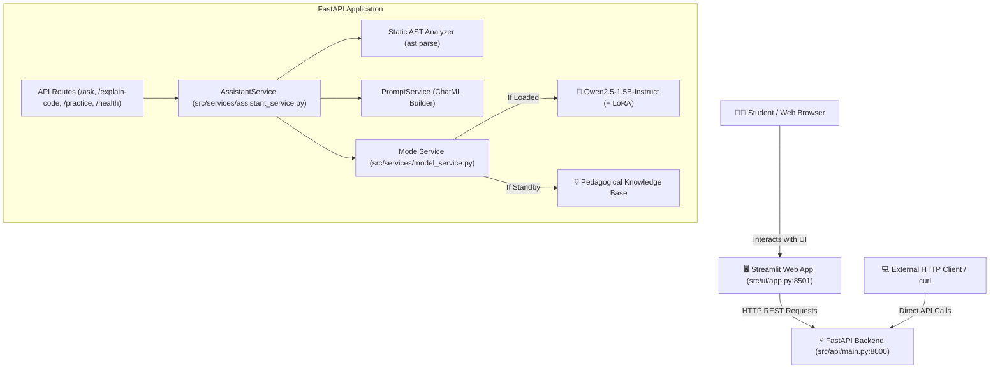

# Python Learning Assistant Using Small Language Model (SLM)

An end-to-end, locally runnable AI application designed to help beginner students learn Python programming concepts using an instruction-tuned Small Language Model (SLM).

---

## 📌 Project Overview

This project implements a complete Small Language Model (SLM) solution for beginner Python education without relying on paid hosted LLM APIs (such as OpenAI or Gemini).

### Core Capabilities
- **Beginner Q&A:** Answers conceptual Python questions in plain, accessible language.
- **Code Explanation:** Deconstructs Python snippets line-by-line.
- **Error Diagnostics:** Explains exceptions and common syntax/runtime errors with actionable fixes.
- **Code Generation:** Provides idiomatic, beginner-friendly Python examples.
- **Practice Generation:** Creates targeted exercises with progressive hints.

---

## 💻 Hardware & Environment Profile (Verified Audit)

The environment has been independently audited and verified on the physical Acer laptop:
- **Operating System:** Windows 11 Home / Pro (Build 10.0.26200, AMD64)
- **CPU:** Intel(R) Core(TM) i3-N305 (8 physical Alder Lake-N cores, 8 threads, ~1.80 GHz base)
- **Host RAM:** **7.75 GB Total Physical RAM** (~0.50–0.86 GB free under nominal desktop load, 93% load)
- **Pagefile (Virtual Memory):** 12.95 GB Total (1.94 GB Available)
- **Dedicated GPU:** **None** (System uses integrated **Intel(R) UHD Graphics**; no NVIDIA discrete GPU or CUDA toolkit)
- **Storage Profile:**
  - **Drive C:\\ (Primary OS):** 136.96 GB Total, **7.48 GB Free**
  - **Drive D:\\ (Data Partition):** 50.00 GB Total, **49.91 GB Free** (used for `HF_HOME=D:\huggingface_cache`)
- **Python Toolchain:** Python 3.10.11 (`C:\Users\acer\AppData\Local\Programs\Python\Python310\python.exe`)
- **Version Control:** Git 2.54.0.windows.1

### Key Engineering Decisions for this Environment
1. **Local Inference:** Lightweight SLM running in CPU mode with memory-conscious configurations (INT4/GGUF or quantized settings) to avoid out-of-memory errors on 7.75 GB RAM.
2. **LoRA Fine-Tuning & Primary Benchmarking:** Parameter-Efficient Fine-Tuning (PEFT / LoRA) and batch benchmarking executed on **Google Colab GPU** (NVIDIA Tesla T4 with 15.36 GB VRAM) to guarantee fast convergence and eliminate local host OOM crashes.
3. **Storage Hygiene:** Models and virtual environments are strictly isolated; Hugging Face cache is directed to **Drive D:\\ (`D:\huggingface_cache`)** to safeguard the 7.48 GB free space on Drive C:\\.

---

## 📁 Repository Structure

```
slm-python-learning-assistant/
│
├── README.md                           # Master project documentation
├── requirements.txt                    # Project dependencies for Python 3.10
├── .gitignore                          # Git ignore rules for virtualenvs, models, caches
├── .env.example                        # Environment variable template
│
├── configs/
│   └── model_config.yaml               # Centralized hyperparameters & model settings
│
├── data/
│   ├── raw/
│   │   ├── python_qa_raw.jsonl         # 382 raw curated instruction-tuning pairs
│   │   └── python_qa_raw.backup.jsonl  # Verified raw data backup
│   ├── processed/
│   │   ├── train.jsonl                 # 306 records (80.1% Training set)
│   │   ├── validation.jsonl            # 38 records (9.9% Validation set)
│   │   └── test.jsonl                  # 38 records (9.9% Held-out test set)
│   ├── train.jsonl                     # Root mirror for config compatibility
│   ├── validation.jsonl                # Root mirror for config compatibility
│   └── test.jsonl                      # Root mirror for config compatibility
│
├── notebooks/
│   ├── baseline_evaluation.ipynb       # Reproducible baseline evaluation on Colab GPU
│   └── phase5_lora_training.ipynb      # Google Colab LoRA fine-tuning notebook
│
├── scripts/
│   ├── inspect_env.py                  # Standalone hardware & system inspection utility
│   └── compile_baseline_results.py     # Benchmark results aggregator
│
├── src/
│   ├── __init__.py
│   ├── data/
│   │   ├── __init__.py
│   │   ├── prepare_dataset.py          # Dataset compiler across 18 domains
│   │   ├── validate_dataset.py         # Multi-check schema, duplicate, AST & safe execution validator
│   │   └── split_dataset.py            # Leakage-proof cluster-based 80:10:10 splitter
│   ├── model/
│   │   ├── __init__.py
│   │   ├── load_model.py               # Singleton auto-device loader & memory auditor
│   │   ├── inference.py                # ChatML inference engine & benchmarking pipeline
│   │   ├── lora_config.py              # Audited LoRA hyperparameters & Qwen2 architecture mapping
│   │   └── train_lora.py               # SFT pipeline with loss masking & test-set isolation
│   ├── evaluation/
│   │   ├── __init__.py
│   │   ├── training_metrics.py         # Perplexity tracking, convergence & overfitting diagnostics
│   │   └── evaluate.py                 # Multi-metric benchmark (AST, validity, latency)
│   ├── optimization/
│   │   ├── __init__.py
│   │   └── quantize.py                 # 4-bit NF4 quantization, AST validator & benchmark suite
│   ├── services/
│   │   ├── __init__.py
│   │   ├── prompt_service.py           # ChatML prompt formatting for Q&A, code, practice
│   │   ├── model_service.py            # Singleton model loader, hardware auditor & memory safeguard
│   │   └── assistant_service.py        # Orchestrator with static AST analysis & structured fallback
│   ├── api/
│   │   ├── __init__.py
│   │   ├── main.py                     # FastAPI application entrypoint & CORS configuration
│   │   ├── schemas.py                  # Pydantic request & response validation schemas
│   │   ├── dependencies.py             # Dependency injection providers for services
│   │   └── routes/
│   │       ├── health.py               # GET /health and POST /model/load endpoints
│   │       ├── ask.py                  # POST /ask student Q&A endpoint
│   │       ├── explain_code.py         # POST /explain-code line-by-line AST endpoint
│   │       └── practice.py             # POST /practice exercise generator endpoint
│   └── ui/
│       ├── __init__.py
│       └── app.py                      # Interactive multi-tab Streamlit web application
│
├── tests/
│   ├── __init__.py
│   ├── test_dataset.py                 # Pytest suite: schema, splits, zero-leakage, AST (8 tests)
│   ├── test_inference.py               # Pytest suite: ChatML prompt formatting & configs (5 tests)
│   ├── test_lora_config.py             # Pytest suite: exact LoRA parameter math & loss masking (12 tests)
│   ├── test_optimization.py            # Pytest suite: 4-bit quantization, AST & throughput (9 tests)
│   ├── test_evaluation.py              # Pytest suite: 9-point rubric, test set isolation & AST (11 tests)
│   ├── test_api.py                     # Pytest suite: FastAPI routes, OpenAPI spec & schemas (12 tests)
│   └── test_assistant_service.py       # Pytest suite: Assistant orchestrator, prompts & AST (7 tests)
│
├── experiments/
│   ├── baseline_results.json           # Raw outputs & latencies of baseline SLM across 38 test cases
│   ├── baseline_results.backup.json    # Audited backup of reference baseline
│   ├── optimization_results.json       # Memory & latency benchmark across 3 configurations
│   ├── phase7_results.json             # Phase 7 comparative results matrix (3 configurations)
│   ├── phase7_results.csv              # Phase 7 comparative summary table
│   └── evaluation_results.json         # Comparative evaluation records
│
└── reports/
    ├── hardware_audit.md               # Independent hardware audit & memory calculations
    ├── phase1_audit.md                 # Phase 1 audit & remediation log
    ├── model_comparison.md             # Phase 2: SLM Candidate Comparison & Selection
    ├── dataset_quality_report.md       # Phase 3: Comprehensive AST & Execution audit report
    ├── phase3_report.md                # Phase 3: Master dataset preparation report
    ├── baseline_report.md              # Phase 4: Baseline model performance analysis
    ├── phase5_corrections.md           # Phase 5: Parameter math, loss masking & license audit
    ├── phase5_report.md                # Phase 5: LoRA fine-tuning architecture report
    ├── phase6_optimization_report.md   # Phase 6: 4-bit NF4 quantization & benchmark report
    ├── phase7_evaluation_report.md     # Phase 7: Post-adaptation benchmark & evaluation report
    ├── phase7_manual_review.md         # Phase 7: 9-point rubric qualitative review protocol
    ├── benchmark_report.md             # Phase 7: Historical benchmark summary
    └── phase8_deployment_report.md     # Phase 8: FastAPI backend & Streamlit UI deployment report
```

---

## 🌐 FastAPI Backend & Streamlit Web Interface

Phase 8 introduces a production-grade FastAPI REST backend coupled with an interactive Streamlit web interface, designed to operate safely within the host machine's hardware constraints (7.75 GB RAM, no discrete GPU).

### System Architecture



### Running the Application

#### 1. Start the FastAPI Backend
```bash
uvicorn src.api.main:app --host 127.0.0.1 --port 8000 --reload
```
- API Base URL: `http://127.0.0.1:8000`
- Interactive Swagger UI: `http://127.0.0.1:8000/docs`
- Interactive ReDoc: `http://127.0.0.1:8000/redoc`

#### 2. Start the Streamlit Web Application
In a separate terminal:
```bash
streamlit run src/ui/app.py
```
- Web Application URL: `http://localhost:8501`

---

## 📡 REST API Reference & Endpoints

### 1. `GET /` — Service Root
Returns service name, version, status, and API documentation link.
```bash
curl -X GET "http://127.0.0.1:8000/"
```
**Response (200 OK):**
```json
{
  "project": "slm-python-learning-assistant",
  "version": "1.0.0",
  "status": "operational",
  "docs_url": "/docs"
}
```

---

### 2. `GET /health` — Hardware & Model Health Status
Reports system RAM headroom, CUDA GPU availability, model load status, and active execution mode.
```bash
curl -X GET "http://127.0.0.1:8000/health"
```
**Response (200 OK):**
```json
{
  "status": "standby",
  "project": "slm-python-learning-assistant",
  "version": "1.0.0",
  "model_id": "Qwen/Qwen2.5-1.5B-Instruct",
  "revision": "c644d673f4439c36291a1827471fb3be52382e26",
  "model_loaded": false,
  "adapter_exists": false,
  "adapter_loaded": false,
  "cuda_available": false,
  "gpu_name": null,
  "gpu_vram_gb": 0.0,
  "host_ram_total_gb": 7.75,
  "host_ram_avail_gb": 0.75,
  "active_configuration": "development_fallback",
  "adapter_status": "pending_colab_training"
}
```

---

### 3. `POST /ask` — Student Python Q&A
Answers conceptual Python questions in simple English with clean code illustrations.
```bash
curl -X POST "http://127.0.0.1:8000/ask" \
  -H "Content-Type: application/json" \
  -d '{"question": "How do lists work in Python and how do I append items?"}'
```
**Response (200 OK):**
```json
{
  "question": "How do lists work in Python and how do I append items?",
  "answer": "### Explanation:\nA list in Python is an ordered, mutable sequence that can store elements of various data types.\n\n### Key Concepts:\n- Lists use square brackets [].\n- Lists are mutable (can be modified in-place).\n- Elements are zero-indexed.\n\n### Python Example:\n```python\nfruits = ['apple', 'banana', 'orange']\nfruits.append('mango')\nprint(fruits[0])  # Output: apple\n```",
  "code_example": "fruits = ['apple', 'banana', 'orange']\nfruits.append('mango')\nprint(fruits[0])  # Output: apple",
  "mode": "development_fallback",
  "model_status": "not_loaded",
  "latency_seconds": 0.001,
  "note": "Response generated via development fallback. Real SLM inference requires loaded Qwen2.5-1.5B model."
}
```

---

### 4. `POST /explain-code` — Static AST Line-by-Line Code Explainer
Deconstructs Python code line-by-line and diagnoses syntax errors without executing untrusted code on the host.
```bash
curl -X POST "http://127.0.0.1:8000/explain-code" \
  -H "Content-Type: application/json" \
  -d '{"code": "def square(x):\n    return x * x\n\nresult = square(4)\nprint(result)"}'
```
**Response (200 OK):**
```json
{
  "code": "def square(x):\n    return x * x\n\nresult = square(4)\nprint(result)",
  "syntax_valid": true,
  "syntax_error": null,
  "explanation": "The provided Python code contains 5 lines and is syntactically valid.\n\n### Line-by-Line Walkthrough:\n- **Line 1** (`def square(x):`): Defines function 'square'.\n- **Line 2** (`return x * x`): Returns output value from function to caller.\n- **Line 4** (`result = square(4)`): Assigns value to variable.\n- **Line 5** (`print(result)`): Outputs value to standard console.",
  "line_by_line": [
    {"line_number": 1, "code": "def square(x):", "explanation": "Defines function 'square'."},
    {"line_number": 2, "code": "    return x * x", "explanation": "Returns output value from function to caller."},
    {"line_number": 4, "code": "result = square(4)", "explanation": "Assigns value to variable."},
    {"line_number": 5, "code": "print(result)", "explanation": "Outputs value to standard console."}
  ],
  "mode": "development_fallback",
  "model_status": "not_loaded",
  "latency_seconds": 0.002,
  "note": "Analysis generated via static AST analysis and fallback logic."
}
```

---

### 5. `POST /practice` — Practice Exercise Generator
Generates targeted practice problems with graduated hints and solution code.
```bash
curl -X POST "http://127.0.0.1:8000/practice" \
  -H "Content-Type: application/json" \
  -d '{"topic": "lists", "difficulty": "beginner"}'
```
**Response (200 OK):**
```json
{
  "topic": "lists",
  "difficulty": "beginner",
  "title": "Reverse and Filter Positive Numbers",
  "problem_statement": "Write a function `filter_positives(nums)` that takes a list of integers and returns only the positive numbers in reverse order.",
  "starter_code": "def filter_positives(nums: list[int]) -> list[int]:\n    # Your code here\n    pass\n",
  "hints": [
    "Hint 1: You can filter numbers using a list comprehension with an 'if num > 0' condition.",
    "Hint 2: To reverse a list, you can use slice notation `[::-1]` or the `reversed()` function.",
    "Hint 3: Combining both: `[x for x in nums if x > 0][::-1]`"
  ],
  "solution": "def filter_positives(nums):\n    return [x for x in nums if x > 0][::-1]",
  "mode": "development_fallback",
  "model_status": "not_loaded",
  "latency_seconds": 0.001,
  "note": "Practice problem generated via development fallback."
}
```

---

### 6. `POST /model/load` — Explicit Model Loading Trigger
Explicitly triggers loading of model weights into memory. Protected by host memory headroom verification (requires $\ge 1.5$ GB available RAM).
```bash
curl -X POST "http://127.0.0.1:8000/model/load" \
  -H "Content-Type: application/json" \
  -d '{"force_cpu": false}'
```

---

## 🧪 Testing & Verification

Run the full automated Pytest suite (64 unit and integration tests across 7 modules, 100% passing in ~7.6s):

```bash
# Run all unit tests
pytest -v
```

---

## 🎯 LoRA Fine-Tuning & Adapter Loading

### Fine-Tuning Execution (Google Colab GPU)
Due to laptop host memory constraints (7.75 GB RAM, no discrete GPU), LoRA fine-tuning is configured to run in Google Colab on a Tesla T4 GPU:

1. Open `notebooks/phase5_lora_training.ipynb` in Google Colab with a GPU runtime (T4 FP16).
2. The notebook clones the repository or loads `data/processed/train.jsonl` (306 examples) and `data/processed/validation.jsonl` (38 examples).
3. The training pipeline applies:
   - Rank $r=8$, $\alpha=16$, dropout=0.05 on all 7 linear projections (`q_proj`, `k_proj`, `v_proj`, `o_proj`, `gate_proj`, `up_proj`, `down_proj`).
   - Exact verified parameter count: **9,232,384 trainable parameters** (**0.5981%** of base model).
   - ChatML prompt masking: Loss is strictly computed on assistant responses (prompt tokens masked with `labels = -100`).
   - Strict test-set isolation assertion: verifies zero overlap with `data/processed/test.jsonl`.
4. Outputs the trained PEFT adapter to `artifacts/lora_adapter/`.

To perform a pre-flight dry-run locally:
```bash
python src/model/train_lora.py
```

### Loading the Fine-Tuned Adapter (Unquantized FP16)
To load the fine-tuned LoRA adapter on top of `Qwen2.5-1.5B-Instruct`:

```python
from transformers import AutoModelForCausalLM, AutoTokenizer
from peft import PeftModel
import torch

base_model_id = "Qwen/Qwen2.5-1.5B-Instruct"
pinned_revision = "c644d673f4439c36291a1827471fb3be52382e26"
adapter_dir = "artifacts/lora_adapter"

# 1. Load base tokenizer and model
tokenizer = AutoTokenizer.from_pretrained(base_model_id, revision=pinned_revision)
base_model = AutoModelForCausalLM.from_pretrained(
    base_model_id,
    revision=pinned_revision,
    torch_dtype=torch.float16 if torch.cuda.is_available() else torch.float32,
    device_map="auto"
)

# 2. Attach LoRA adapter
model = PeftModel.from_pretrained(base_model, adapter_dir)
model.eval()
```

### Loading the 4-bit NF4 Quantized Model with Adapter
For memory-constrained local environments (~1.7 GB VRAM / operational memory):

```python
from src.optimization.quantize import load_quantized_model_with_adapter

model, tokenizer, meta = load_quantized_model_with_adapter(
    model_id="Qwen/Qwen2.5-1.5B-Instruct",
    adapter_dir="artifacts/lora_adapter"
)
```

---

## 🚀 Development Workflow Roadmap

- [x] **Phase 1: Environment & Workspace Verification** — Hardware auditing, git initialization, modular project layout, initial configurations.
- [x] **Phase 1 Audit & Remediation** — Independent re-audit, `scripts/inspect_env.py`, memory footprint modeling, updated documentation.
- [x] **Phase 2: SLM Research & Model Selection** — Comparative research on Qwen2.5-1.5B, SmolLM2-1.7B, and Llama-3.2-1B against local CPU & Colab GPU profiles.
- [x] **Phase 3: Dataset Preparation & Validation** — 382 QA pairs across 18 beginner topics, 100% AST-valid code blocks, safe execution validation (200/200 passed), leakage-free 80:10:10 split.
- [x] **Phase 4: Baseline Model Implementation & Evaluation** — Pretrained `Qwen2.5-1.5B-Instruct` benchmark across 38 held-out test cases, ChatML formatting, latency/throughput profiling, `experiments/baseline_results.json`, and `reports/baseline_report.md`.
- [x] **Phase 5: LoRA Fine-Tuning Pipeline & Architecture** — Validated `SLMLoRAConfig` (r=8, α=16), loss-masked SFT pipeline (`train_lora.py`), Colab GPU notebook (`phase5_lora_training.ipynb`), exact LoRA parameter derivation (9,232,384 params / 0.5981%), and Phase 5 corrections audit report (`reports/phase5_corrections.md`).
- [x] **Phase 6: Model Optimization & Controlled Benchmarking** — 4-bit NF4 quantization (`src/optimization/quantize.py`), adapter preservation, AST code validator, generation parameter optimization, 34 automated unit tests, and optimization report (`reports/phase6_optimization_report.md`).
- [x] **Phase 7: Post-Adaptation Benchmark & Comprehensive Evaluation** — 9-point qualitative rubric (`src/evaluation/evaluate.py`), AST syntax verification, host code quarantine directives, base model parameter count verification (1,543,714,304), 45 automated unit tests (100% pass), and evaluation report (`reports/phase7_evaluation_report.md`).
- [x] **Phase 8: FastAPI Backend & Streamlit Frontend** — Production REST API (FastAPI), interactive multi-tab UI (Streamlit), hardware memory safeguards, 64 passing automated unit tests, and comprehensive deployment report (`reports/phase8_deployment_report.md`).

---

## 📄 License & Attribution
Designed for educational purposes as an internship / mentor assignment. Free and open-source models and libraries only.
Dataset and project materials are licensed under the MIT / CC-BY-4.0 license.
